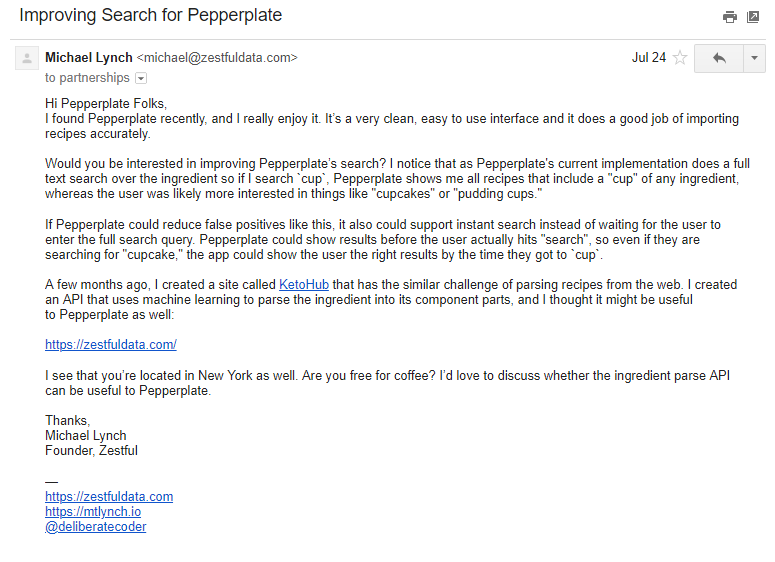
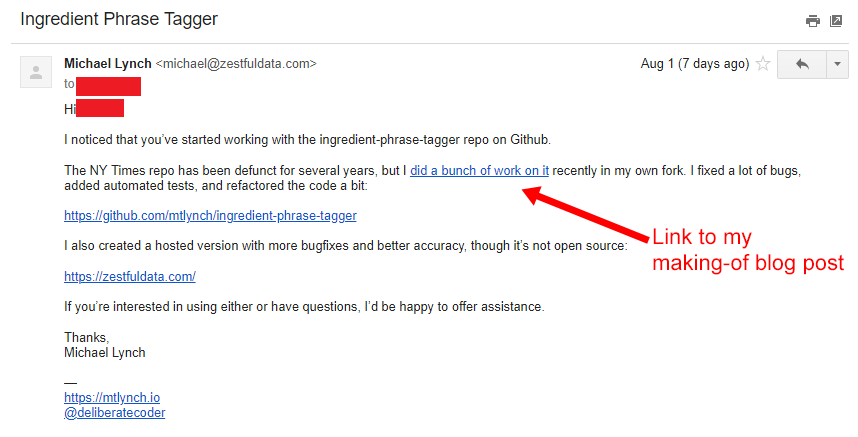

## Background

Zestful Data provides paid APIs to assist recipe and cooking apps. My first API is a recipe ingredient parser.

Given an ingredient string like `"1 1/2 cups finely chopped red onions"`, the API gives back a JSON dictionary like this:

```json
{
  "quantity": 1.5,
  "unit": "cup",
  "product": "red onions",
  "preparationNotes": "finely chopped"
}
```

## Previous months

- Month 1 (March 2018): Floated idea to potential customer, began working on proof-of-concept
- Month 2 (April 2018): Contractor continued working on proof-of-concept (~10 hours per week)
- Month 3 (May 2018): Proof-of-concept working, added a REST API and [demo site](https://zestfuldata.com) for beta testing
- [Month 4 (June 2018)](/retrospectives/2018/07/): Iterated on API based on feedback from beta testers

## Achievements for July

In my [last update](/retrospectives/2018/07/), I set the following goals for July, and I achieved all of them:

- Main goal: Get something up for sale ASAP. **DONE**
- Commission basic logo ($200) for API marketplace. **DONE**
- Publish first endpoint to API marketplace. **DONE**
- Add unit conversion support for customer who requested it. **DONE**
- Continue reaching out to recipe app developers to try to set up calls. **DONE**

## Customers

I launched on July 5th, but I still have zero paying customers.

I've been communicating with one prospective customer for several months, starting before I even had any working code. He's expressed strong interest for a project he's implementing now, but he hasn't started experimenting seriously with the API yet.

Another prospective customer emailed me with the subject, "I'd pay for your ingredient parser if it had this." He wanted support for unit conversion (e.g., US to metric, scale ingredients by serving size then simplify to most appropriate unit of measure). I spent two weeks adding support for this, but he hasn't tested it out yet. I followed up, and he said he's traveling for the next month but will try it when he returns. I may have overinvested here because it does feel silly to dedicate two dev weeks to a single customer whose use case doesn't seem very common, but it would be worth it to get my first dollar of MRR.

## Cold emailing

So far, I've been pretty unsuccessful with cold emailing app developers:

- Company 1: 2 cold emails ending in a "no"
- Company 2: 1 cold email, ending in a "no"
- Company 3: 2 cold emails, ending in a "no"
- Company 4: 2 cold emails, no response
- Company 5: 1 cold email, no response

{{}}

When I get a "no" I always ask if there are other APIs they'd want but don't have time to implement themselves, but nobody has requested anything and they usually don't respond after "no."

I've also been monitoring the [original library](https://github.com/NYTimes/ingredient-phrase-tagger) that my API improves upon. When I see new developers star or fork it, I send them an email to let them know I added a lot of bugfixes to it and I have a hosted version that's even better. So far, 4 developers contacted, 0 responses.

{{}}

## Content marketing

I spent a lot of time in July on writing [blog posts](/) related to my API. I've previously been successful at attracting large audiences through blog posts, and I figure even if this project isn't successful, it's helpful to continue building my blog audience. My two most promising leads both found out about the project through my previous blog posts.

In the last month, I published two blog posts about the making of this API:

- [Resurrecting a Dead Library: Part One - Resuscitation](/resurrecting-1/)
- [Resurrecting a Dead Library: Part Two - Stabilization](/resurrecting-2/)

The first one got 1,062 unique readers its first week. That's on the low side for my blog, so it didn't get the response I was hoping for, but it still led to two new trial-plan signups on the API marketplace. It also led to two inbound leads from people who want to use the API, though neither have materialized to anything yet.

The second post hasn't been up a full week, but only got 213 unique readers in its first three days, so it kind of flopped. It didn't yield any new signups and barely anyone even clicked through to the API homepage from the article.

## Promotional partnerships

I'm working with another founder I met at the June IH Meetup on a demo that will showcase both of our products and how they integrate.

Another developer found me through my blog post and inquired about using my API for a data visualization project (he's had several high-visibility ones in the past).

## What went well

- I launched!
- I've made valuable connections through IH meetups and inbound inquiries from the blog

## What I could have done better

- Overcommitted to a blog post series
  - The making-of blog posts haven't been that popular, but I announced from the beginning that it was a series of three posts, so now I'm kind of committed to completing the series
  - I don't think they have the broad appeal of my more popular posts because I think they get farther into the nitty-gritty of the code than most people are interested in

## Plans for August

- Pound the pavement: There are dozens of recipe apps out there, and I've only contacted a few. I'm going to keep contacting developers.
- Content marketing, but a little less tech-heavy
  - In my [last update](/retrospectives/2018/07/), I touched on how I tricked myself into shipping too late. I think that could be expanded to an interesting blog post.
