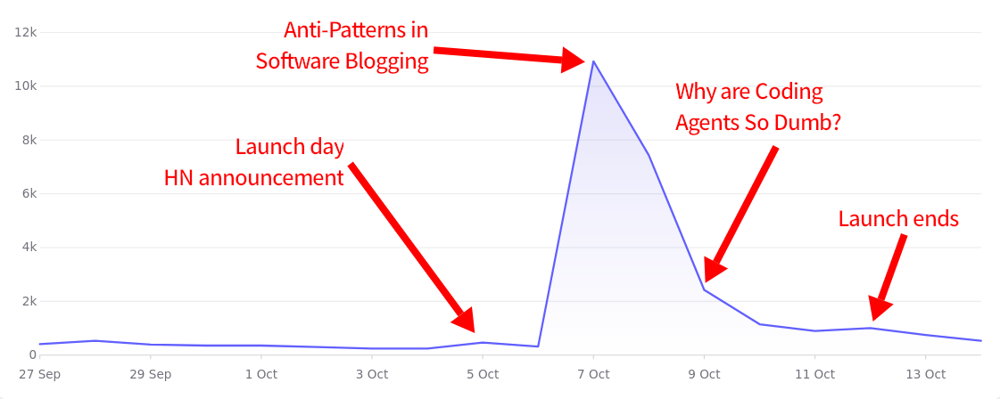
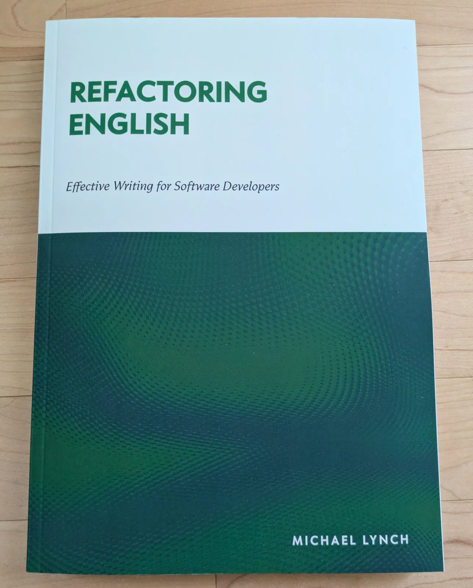
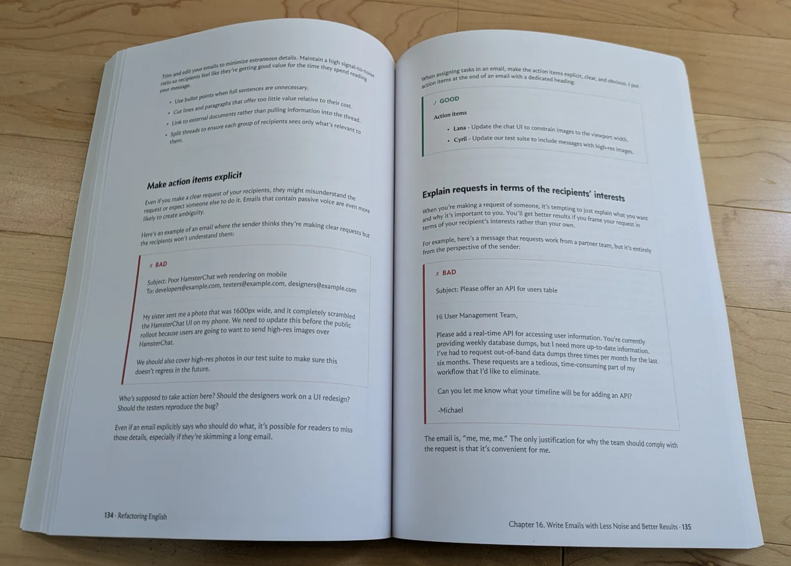
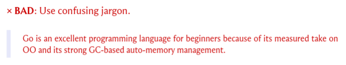
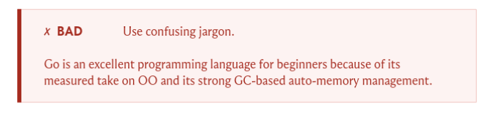



**New here?**

Hi, I'm Michael. I'm a software developer and founder of small, indie tech businesses. I'm currently working on a book called [_Refactoring English: Effective Writing for Software Developers_](https://refactoringenglish.com).

Every month, I publish a retrospective like this one to share how things are going with my book and my professional life overall.



## Highlights

- I launched my book and made lots of typography improvements to it.
- I've had mixed experiences with Lulu Direct Buy Button.
- I created a Markdown to Asciidoc compiler so I can stop writing in Asciidoc.

## Goal grades

At the start of each month, I declare what I'd like to accomplish. Here's how I did against those goals:

### Announce the official launch of the book

- **Result**: Launched the book (a week late)
- **Grade**: A

This is finally complete!

I got caught in a loop because there's a one week turnaround between ordering a print and getting to see what a physical copy looks like. So, I'd order a print and make some improvements while I was waiting. By the time I received the test print, I wanted to include the last week of improvements, so I had to order another test print and wait another week. And while I was waiting, I made more improvements...

Finally, I had to decide that a version was good enough and that it was ready for customers, but I'm continuing to make small tweaks on a rolling release basis.

### Pitch to two podcasts

- **Result**: Pitched to just one podcast
- **Grade**: C

I ended up spending a lot more time than I expected touching up the print version, so I had less time to pitch to podcasts.

### Publish a new blog post that attracts readers to the book's website

- **Result**: Published ["Anti-Patterns in Software Blogging"](https://refactoringenglish.com/blog/anti-patterns-software-blogging/) and ["Why are Agent Harnesses so Dumb?"](https://mtlynch.io/why-are-coding-agents-so-dumb/) during my book's launch week
- **Grade**: A

Both posts reached the front page of Hacker News, Lobsters, and /r/programming. I was happy with these results, especially because one of my selling points of the book is that you can writing helps customers find you. It was nice to prove that with blog posts that led readers to purchase the book.

## _Refactoring English_ metrics



September was the second best month of visitors for the book, though I didn't directly cause it.

Most visitors arrived because a reader submitted my ["How to Write an Effective Software Design Document"](https://refactoringenglish.com/excerpts/write-an-effective-design-doc/) post to both /r/programming and Hacker News, and the post took off in both places.

The post's success was surprising because the same article had been submitted to Hacker News [nine times before](https://hn.algolia.com/?dateRange=all&page=0&prefix=true&query=https%3A%2F%2Frefactoringenglish.com%2Fexcerpts%2Fwrite-an-effective-design-doc%2F&sort=byPopularity&type=story) and never took off. Tenth time's the charm, as they say. And I'd [submitted the post to /r/programming](https://old.reddit.com/r/programming/comments/1uevttg/how_to_write_an_effective_software_design_document/) a few months ago, and it _did_ take off, but I guess everyone forgot or was happy to [read it again two months later](https://old.reddit.com/r/programming/comments/1wd1jt9/how_to_write_an_effective_software_design_document/).

## My book's launch week

I normally cover the previous month in these retros, which would be September, but since I'm late and the October launch is fresh in my mind, I'll cover it here.

I officially launched my book! Launch week was October 4th to 11th. I offered a print version for the first time and offered a limited-time 30% discount on both the print and digital versions.

Here were my launch week promotional activities, in decreasing order of impact on sales:

- Published ["Anti-Patterns in Software Blogging"](https://refactoringenglish.com/blog/anti-patterns-software-blogging/)
  - Went to #1 on [Lobsters](https://lobste.rs/s/rwdufq/anti_patterns_software_blogging), [/r/programming](https://www.reddit.com/r/programming/comments/1wzw4cw/antipatterns_in_software_blogging/) and peaked at #8 on [Hacker News](https://news.ycombinator.com/item?id=49992257)
- Published ["Why are Agent Harnesses so Dumb?"](https://mtlynch.io/why-are-coding-agents-so-dumb/)
  - It got a decent response on [Hacker News](https://news.ycombinator.com/item?id=50020947) and [Lobsters](https://lobste.rs/s/t5htlf/why_are_coding_agents_so_dumb)
- Submitted an announcement [to Hacker News](https://news.ycombinator.com/item?id=49964837)
  - Never made it to the front page
- Announced launch to my book email list
- Announced launch to my personal blog email list

{{}}

Here are some high-level metrics comparing launch week sales to the prior week for reference:

<div id="launch-week-sales">
  <canvas id="launch-week-sales-chart" role="img" aria-label="Copies sold on the left axis, and revenue and profit in US dollars on the right axis, comparing the prior week with launch week. Ebook and print are stacked to show totals. Exact values are in the table below."></canvas>
</div>

<script type="module" src="launch-week-sales.js"></script>

| Metric               | Prior Week  | Launch Week   | Change               |
| -------------------- | ----------- | ------------- | -------------------- |
| Unique visitors      | 2,379       | 23,478        |      |
| Sale count (ebook)   | 8           | 70            |      |
| Sale revenue (ebook) | $355.56     | $1,897.41     |      |
| Profit (ebook)       | $339.09     | $1,801.27     |      |
| Sale count (print)   | 0           | 57            |      |
| Sale revenue (print) | $0          | $1,772.42     |      |
| Profit (print)       | $0          | $453.16       |      |
| Sale count (total)   | 8           | 127           |      |
| Sale revenue (total) | $355.56     | $3,669.83     |      |
| **Profit (total)**   | **$339.09** | **$2,254.43** | **** |

## The evolution of the print version

I initially planned not to put much effort into the print version. The PDF version already looked pretty good, and customers have been buying it for over a year with no complaints about the design, so I wasn't about to become a typography wonk over a print version.

Then, a reader named Alexey Zubkov reached out to me with a few suggestions for my book and offered to help me with the typography. Once Alexey pointed out the issues, they felt like huge, glaring errors, even though I'd been staring at this book for years and never noticed them.

One of my blind spots was that I wasn't using my font's pair-specific kerning. Without pair-specific kerning, Asciidoctor gives each letter a fixed slot of horizontal space regardless of which letter follows it. When it honors pair-specific kerning, Asciidoctor adjusts the horizontal spacing for certain combinations like "Yo":

{{}}
{{}}

Notice that with pair-specific kerning, part of the "o" appeears directly under the "Y"

{{}}

The two letters can share that space because the font designer knows the combination works, whereas if it was lowercase "yo," the letters would collide.

And that's just one change!

I made a little slideshow to show how a single page evolved over about 30 different typography improvements, and this still excludes many that had no impact on the example page:

<div id="book-slideshow" role="region" aria-label="Book page revisions">
  <figure class="book-slide-pair" aria-live="polite" aria-atomic="true">
    <a class="book-slide-link" href="/retrospectives/2026/10/timelapse/2026-09-07T15:50:13Z_afcd884f.webp">
      
      <span class="book-slide-error" hidden>Image unavailable. Use the controls to try another revision.</span>
    </a>
    <a class="book-slide-link" href="/retrospectives/2026/10/timelapse/2026-09-07T15:57:31Z_f7a455ef.webp">
      
      <span class="book-slide-error" hidden>Image unavailable. Use the controls to try another revision.</span>
    </a>
    <figcaption>
      <p class="book-slide-caption">Add GOOD/BAD prefix and icons to examples</p>
    </figcaption>
  </figure>
  <div id="book-slide-controls" hidden>
    <div class="book-slide-control-group">
      <button id="book-slide-first" type="button" aria-disabled="true"><span aria-hidden="true">⇤</span> First</button>
      <button id="book-slide-previous" type="button" aria-disabled="true">← Previous</button>
    </div>
    <div class="book-slide-control-group">
      <button id="book-slide-next" type="button">Next →</button>
      <button id="book-slide-last" type="button">End <span aria-hidden="true">⇥</span></button>
    </div>
  </div>
  <noscript><p>Enable JavaScript to browse the remaining revisions.</p></noscript>
</div>

<script src="slideshow.js" defer></script>

## My experience using Lulu Direct Buy Button

I'm selling the print copies of the book through Lulu, using a feature they recently added called Direct Buy Button. The basic idea is that you upload your book as a PDF, and they give you a link where people can buy a print version. Lulu offers print on demand, so they print a new copy for the customer and ship it directly to them.

Lulu Direct Buy Button is significantly simpler than Shopify or WooCommerce, where you have to manage a whole ecommerce platform. Its closest parallel is Amazon Kindle Direct Publishing, though without the pain of dealing with the giant Amazon machine.

My overall experience with Lulu has been okay. They deliver on the core promise, which is that they make it easy to sell a book through a link, but there are still a lot of rough edges.


{{}}
{{}}


### Positives

- Fees are transparent and clear.
- Print quality is good.
- Lulu handles fulfillment, so the book goes straight from the printer to the customer.
- It's easy to get up and running.
- The integration with Stripe Connect means authors don't pay double fees for the sales platform and the payment platform.
- Customers haven't reported any issues checking out.
- It's print-on-demand, so you can order in any quantity, down to a single book.
- It's easy to update the contents of the book, and the changes go live instantly for all future orders.

### Negatives

- There's no programmatic way to see order information.
  - Direct Buy Button doesn't support webhooks or any kind of order query API.
  - I reached out to support to see if I was missing something, and they said that the dev team intentionally designed Lulu Direct Buy Button as "a closed ecosystem" but did not elaborate on why anyone would want that.
  - This is the biggest headache because it means I can't programmatically react to purchases, like giving the customer access to the PDF version or the web version.
  - Confusingly, there is an API for order status, but it only works for orders created through the API, so I'd have to reimplement all the server-side logic of Buy Button myself.
  - There's an undocumented GraphQL API for fetching the orders as a CSV, but Lulu invalidates sessions daily and makes every login go through a CAPTCHA, so it would be a pain to try to build automation on top of that API.
- Each product can have exactly one price.
  - I wanted to offer a discounted price for customers who pre-ordered the ebook, but there's no way to offer different prices or discount codes.
  - As a workaround, I created a second, identical book with a lower price, but now any time I update the content of my book, I have to apply the change to two different products.
- There's no built-in support for ordering a test print before releasing a version to customers.
  - If I make a change to the book that could affect the print, I want to do a test print first.
  - I can't mark a draft as "not ready for customers." As soon as I update a draft, that's the draft that ships to customers.
  - I worked around this by creating a _third_ copy of the book that I use for test prints.
- Lulu's CSV export omits important information.
  - You can export order information as a CSV, but you have to do that manually.
  - Bizarrely, the order export has no information about when the orders occurred. There's no date or timestamp column.
  - The CSV export also hides customer information like name and email unless the customer opted in to marketing. And I appreciate Lulu fighting spam, but it's annoying that Lulu views these as Lulu customers rather than my customers. And Lulu exposes the customers' information anyway in the dashboard, but you just can't dump it in aggregate.
- You need to provide a return address even if you don't accept returns.
  - I ended up having to register a virtual mailbox, which is a whole other pain in the butt.
  - I wish Lulu just offered a "recycle the book if you don't want it" refund option.
  - The current setup means customers have to ship a book to me across the country, but I'm just going to recycle it because I can't do anything with a used copy of my book.
- Lulu makes it hard for authors to understand their earnings.
  - They show "Revenue" in a lot of places, but my earnings dashboard said I'd earned $0 even after $2k in sales.
  - I was able to calculate my earnings manually by downloading all my orders as a spreadsheet.
- Customer support is pretty bad.
  - It took several days to respond to my questions, and the answers were unsatisfying.

## Converting my book from Asciidoc to Markdown

I wrote my book in Asciidoc because it was the only tool I could find that outputs to PDF, EPUB, and HTML. By the end, I got so tired of Asciidoc syntax that I spent a day writing (largely with AI) a Markdown to Asciidoc compiler so that I could stop writing in Asciidoc.

Here's an example of the difference. My book contains a lot of example callouts like this:

{{}}

Before, to render callout like the above, I had to write gross Asciidoc that looked like this:

```asciidoc
[.bad-example-block]
--
[.bad-example-header]
× *BAD*: Use confusing jargon.

> [.bad-example]#Go is an excellent programming language for beginners because
> of its measured take on OO and its strong GC-based auto-memory management.#

--
```

The syntax above is especially annoying because most of that is boilerplate that appears in every example, but Asciidoc doesn't support templates, so I have to repeat all the boilerplate every time.

I wrote my own Markdown compiler that supports Hugo-style templates. Now, when I want to generate a bad example callout, I write this simpler and more readable shortcode:

<!-- prettier-ignore -->
```markdown

Go is an excellent programming language for beginners because of its
measured take on OO and its strong GC-based auto-memory management.

```

I also wrote an Asciidoctor plugin to improve the callouts to look like this instead of what I was limited to with native Asciidoctor:

{{}}

The example callouts were where the Markdown syntax was most obviously cleaner, but it also allowed me to stop thinking about Asciidoc's confusing and inconsistent rules like [when a straight quote becomes a curly quote](https://docs.asciidoctor.org/asciidoc/latest/text/quotation-marks-and-apostrophes/). I've set it up so that I just write straight quotes everywhere, and my compiler worries about translating them to the right Asciidoc syntax for curly quotes.

## Tool recommendation: Atuin

I've been meaning to try out [Atuin](https://atuin.sh/) for about a year. It's a tool that collects your full terminal history and can sync it across machines. Every time I'm struggling to remember a command I typed a few days ago and I've lost it to bash's confusing history management rules, I think, "I should really look into Atuin..." And then I keep putting it off.

I finally set aside a few hours to set up Atuin, and it took me less than five minutes to install. I use NixOS, so a basic configuration just looked like this:

```nix
home-manager.users.mike.programs.atuin = {
  enable = true;
  enableBashIntegration = true;
};
```

The biggest decision I had to make was whether to let Atuin take over my up arrow. I didn't realize Atuin took over the up arrow by default, so when it first started happening, I found it jarring. I couldn't decide if Atuin's up-arrow takeover was a worse workflow or if I just needed to adjust, but after about a week of trying to use it, I disabled Atuin from hijacking the up arrow.

Now, the way I search my shell history is:

- `Up Arrow`: Triggers [`history-search-backward`](https://www.gnu.org/software/bash/manual/html_node/Commands-For-History.html#index-history_002dsearch_002dbackward-_0028_0029), bash's built in search for the current session
- `Ctrl+R`: Triggers Atuin to search over all commands across all sessions.

I'm enjoying Atuin. It does exactly what it says. If I know that I've ever typed a command on the terminal, Atuin lets me find it quickly.

My final Atuin config looks like this:

```nix
home-manager.users.mike.programs.atuin = {
  enable = true;
  enableBashIntegration = true;
  # Use bash's default up arrow behavior.
  flags = ["--disable-up-arrow"];
  # Let home-manager manage my Atuin settings.
  forceOverwriteSettings = true;
  settings = {
    # Don't sync to a cloud service.
    auto_sync = false;
    db_path = "/home/michael/.local/share/atuin/history.db";
    dialect = "us";
    # Don't record commands that begin with leading space.
    history_filter = ["^ "];
  };
};
```

## Blog posts I enjoyed

- [Cryptic Comments on an NPR Spotify Show](https://www.thisamericanlife.org/897/transcript)
  - This is a recent episode of _This American Life_ about a producer who found strange comments on an interview with author Elizabeth Gilbert.
  - I read the transcript and then listened to the audio, but I wish I'd listened to the audio first because it was more fun that way.
  - Spoiler: it's the real-life manifestation of The Onion's 2014-but-still-timely video: ["Teens Migrating From Facebook To Comments Section Of Slow-Motion Deer Video."](https://www.youtube.com/watch?v=a4mMY2Kl3GY)
- [Every layer of review makes you 10x slower](https://apenwarr.ca/log/20260316-every-layer-of-review-makes-you-10x-slower)
  - This post is the best articulation I've found about the cognitive dissonance of the speedup I expect from AI vs. how much I experience in practice:
    > Code a simple bug fix: 30 minutes. Get it code reviewed by the peer next to you: 5 hours... AI’s direct impact on this problem is minimal. Okay, so Claude can code it in 3 minutes instead of 30? That’s super, Claude, great work. Now you either get to spend 27 minutes reviewing the code yourself in a back-and-forth loop with the AI (this is actually kinda fun); or you save 27 minutes and submit unverified code to the code reviewer, who will still take 5 hours like before, but who will now be mad that you’re making them read the slop that you were too lazy to read yourself.
- [A Marginal-Utility Case for Stealing My Grandmother’s Pain Pills](https://morewrong.lol/?post=marignal-utility-grandmothers-pain-pills)
  - This is a parody of LessWrong (popular rationalist site) that I thought was pretty funny.
  - I saw [JeffTK describe it as AI-written](https://news.ycombinator.com/item?id=50098276) and thought it was too funny to be AI-generated. The only thing that makes me think it's AI-written is the number of articles (68) that seem to have appeared out of nowhere.
  - It also links to a Substack parody called Smugstack featuring gems like ["I'm an Anti-Racist Educator. It's Not My Job to Educate You"](https://smugstack.lol/p/its-not-my-job-to-educate-you/):
    > Another participant said he was confused by two slides that seemed to contradict each other. I thanked him for showing the group how quickly men become hostile when asked to hold complexity. He said he wasn’t hostile. I asked everyone to notice that he had now interrupted a woman twice. He put his hand down. I said withdrawal is also a form of domination. He put it up again. We took an unscheduled break so I could regulate after what he had put me through.
  - I don't know what to make of the site because all the articles are like two or three orders of magnitude funnier than anything I've seen AI produce, which suggests human writing, but I can't imagine this author was privately writing stuff this good for this long, and nobody noticed until now.
  - My best guess is that the author has a good sense of humor and is injecting the core jokes but is using AI to flesh out the specifics.

## Wrap up

### What got done?

- Officially launched my book.
- Improved a lot of design aspects of the book website, especially the purchase flow.
- Published ["Anti-Patterns in Software Blogging"](https://refactoringenglish.com/blog/anti-patterns-software-blogging/)
- Published ["Why are Agent Harnesses so Dumb?"](https://mtlynch.io/why-are-coding-agents-so-dumb/)

### Lessons learned

- Publishing print books is both harder and easier than I expected.
  - It's easier in that print on demand eliminates a lot of the hassle I anticipated of having to carry inventory and manage logistics.
  - It's harder in that selling a print copy means integrating with another sales platform, and the options are either complex platforms with lots of integration options or simple platforms with no integration options.

### Goals for next month

- Finish remaining typography improvements for the book.
- Publish one new blog post.
