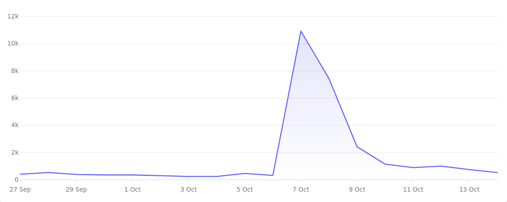



**New here?**

Hi, I'm Michael. I'm a software developer and founder of small, indie tech businesses. I'm currently working on a book called [_Refactoring English: Effective Writing for Software Developers_](https://refactoringenglish.com).

Every month, I publish a retrospective like this one to share how things are going with my book and my professional life overall.



## Highlights

-

## Goal grades

At the start of each month, I declare what I'd like to accomplish. Here's how I did against those goals:

### Goal 1

- **Result**: XX
- **Grade**: XX

TODO

### Goal 2

- **Result**: XX
- **Grade**: XX

TODO

### Goal 3

- **Result**: XX
- **Grade**: XX

TODO

## _Refactoring English_ metrics



This was the second best month of visitors.

## The launch delay cycle

## Launch week

I normally cover the previous month in these retros, but since I'm late and the October launch is fresh in my mind, I'll cover it here.

So, a quick by the numbers comparing sales to the prior week for reference:

| Metric               | Prior Week | Launch Week | Change |
| -------------------- | ---------- | ----------- | ------ |
| Unique visitors      | XX         | XX          | XX     |
| Sale count (ebook)   | XX         | XX          | XX     |
| Sale revenue (ebook) | XX         | XX          | XX     |
| Profit (ebook)       | XX         | XX          | XX     |
| Sale count (print)   | 0          | XX          | XX     |
| Sale revenue (print) | XX         | XX          | XX     |
| Profit (print)       | XX         | XX          | XX     |
| Sale count (total)   | 0          | XX          | XX     |
| Sale revenue (total) | XX         | XX          | XX     |
| Profit (total)       | XX         | XX          | XX     |

Here were my launch week promotional activities:

- Launch announcement on Hacker News
- Launch announcement to book email list
- Launch announcement to mtlynch.io email list
- Published [Anti-Patterns in Software Blogging](https://refactoringenglish.com/blog/anti-patterns-software-blogging/)
  - Went to #1 on [Lobsters](https://lobste.rs/s/rwdufq/anti_patterns_software_blogging), [/r/programming](https://www.reddit.com/r/programming/comments/1wzw4cw/antipatterns_in_software_blogging/) and peaked at #8 on [Hacker News](https://news.ycombinator.com/item?id=49992257)
- Published ["Why are Agent Harnesses so Dumb?"](https://mtlynch.io/why-are-coding-agents-so-dumb/)
  - It got a decent response on [Hacker News](https://news.ycombinator.com/item?id=50020947) and [Lobsters](https://lobste.rs/s/t5htlf/why_are_coding_agents_so_dumb)



An

## Converting my book from Asciidoc to Markdown

I got so tired of Asciidoc syntax that I spent the day writing (largely with AI) a Markdown to Asciidoc compiler.

Before, to render an example callout like this, I had to write this gross Asciidoc:

```asciidoc
[.bad-example-block]
--
[.bad-example-header]
× *BAD*

> [.bad-example]#That was the critical piece for him: the final piece of the puzzle! After months of difficult work, it looked like he'd cracked it.#
>
> [.bad-example]#He called Jacobs and excitedly announced that he'd solved it. She couldn't believe how sudden it all was. "`It was just incredible hearing how quickly it all came together. He got it done in just two weeks, while my team had been on it for months!`"#

--
```

And it's especially annoying because the GOOD and the XX are the same in every good example, but Asciidoc doesn't offer any support for templates.

So, I wrote my own Markdown compiler that supports Hugo-style templates. So, now, when I want to

<!-- prettier-ignore -->
```markdown

That was the critical piece for him: the final piece of the puzzle! After months of difficult work, it looked like he'd cracked it.

He called Jacobs and excitedly announced that he'd solved it. She couldn't believe how sudden it all was. "It was just incredible hearing how quickly it all came together. He got it done in just two weeks, while my team had been on it for months!"

```

This was also helpful in situations where I want to mark a section as `[%unbreakable]`, which tells Asciidoc not to insert a page break within it. And also, whenever I write that, I hear the theme song to _Unbreakable Kimmy Schmidt_ in my head. But Asciidoc has annoying rules about how `[%unbreakable]` combines with other elements, so I didn't know a way to make an example and its preceding paragraph unbreakable. But then I just had AI figure out the semantics so I just write:

<!-- prettier-ignore -->
```markdown


Hello


```

## Side projects

## Recommendation: Atuin

Atuin has been on my list for like a year to check out. I like the idea of it. I don't know if deployment got easier since I last checked in because I recall a dependency on Postgres that I was dreading. But then when I finally set aside a couple of hours to install it, I was done in about five minutes.

This was especially easy because I use NixOS, so installing it just looked like this:

```nix
home-manager.users.mike.programs.atuin = {
  enable = true;
  enableBashIntegration = true;
  # Use bash's default up arrow behavior.
  flags = ["--disable-up-arrow"];
  # Let home-manager manage my Atuin settings.
  forceOverwriteSettings = true;
  settings = {
    # Don't sync to a cloud service.
    auto_sync = false;
    db_path = "/home/mike/.local/share/atuin/history.db";
    dialect = "us";
    # Don't record commands that begin with leading space.
    history_filter = ["^ "];
  };
};
```

The biggest decision I had to make was whether to let it take over my up arrow. I didn't realize Atuin took over the up arrow by default, so when it first started happening, I found it jarring. I spent a few days trying to get used to it to see it was a worse workflow or if it was just unfamiliar.

I found that I prefer bash's default up arrow behavior to Atuin's. Usually, when I hit the up arrow in bash, I am trying to get to a recent command in that specific directory, but I still like having Atuin store my whole shell history because I can hit `Ctrl+R` to search when I'm looking for a command that wasn't in the local shell.

## Wrap up

### What got done?

-

### Lessons learned

-

### Goals for next month

-

### Requests for help

TODO
